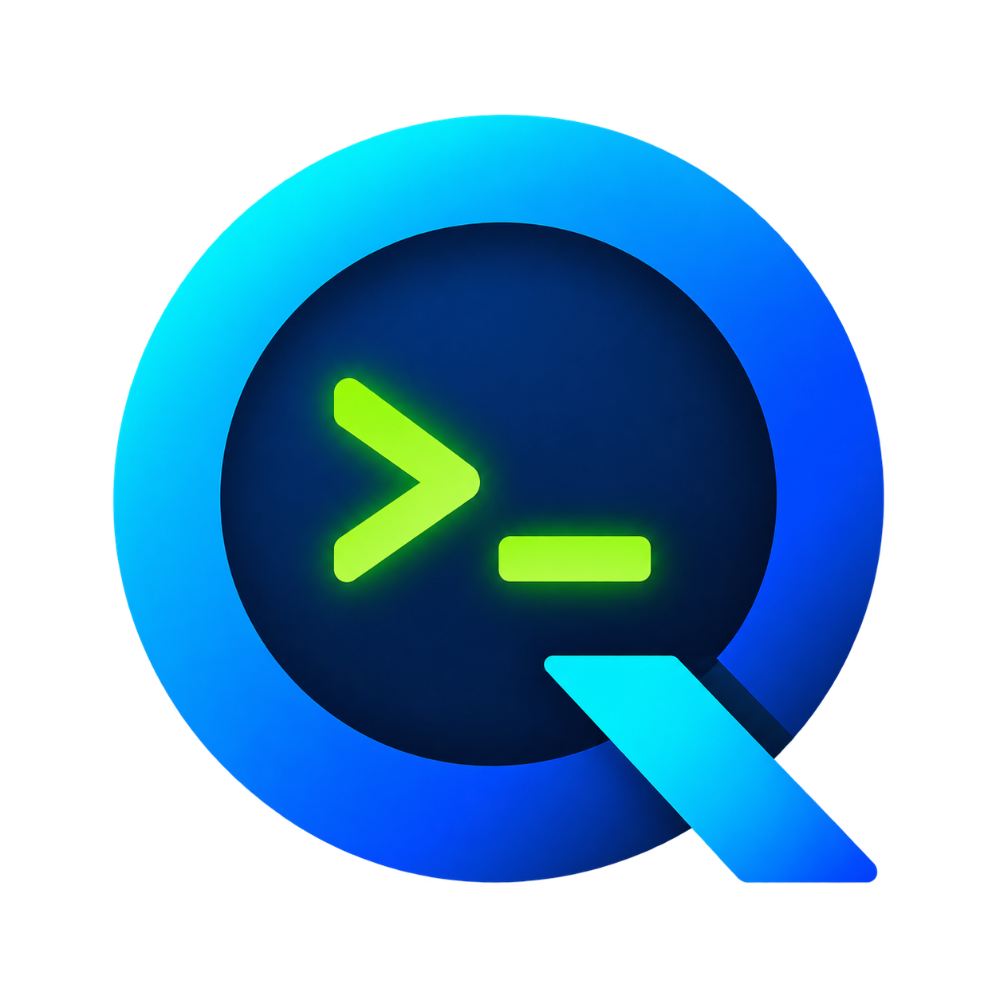
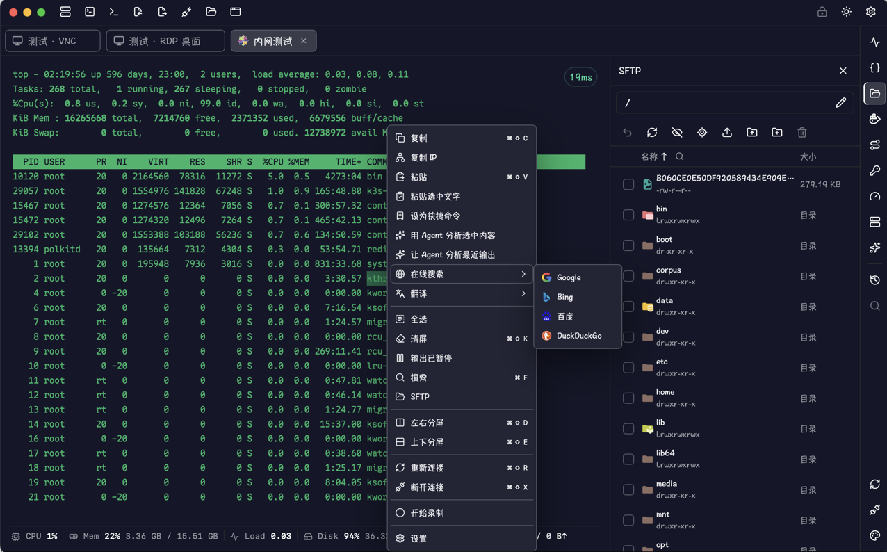
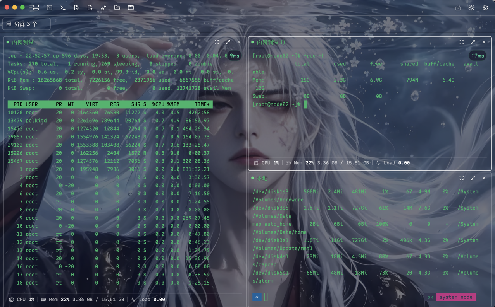
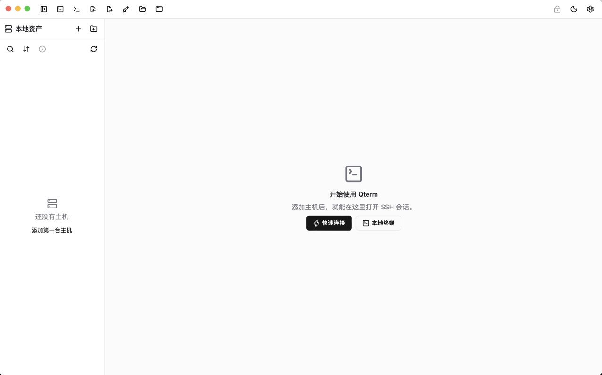
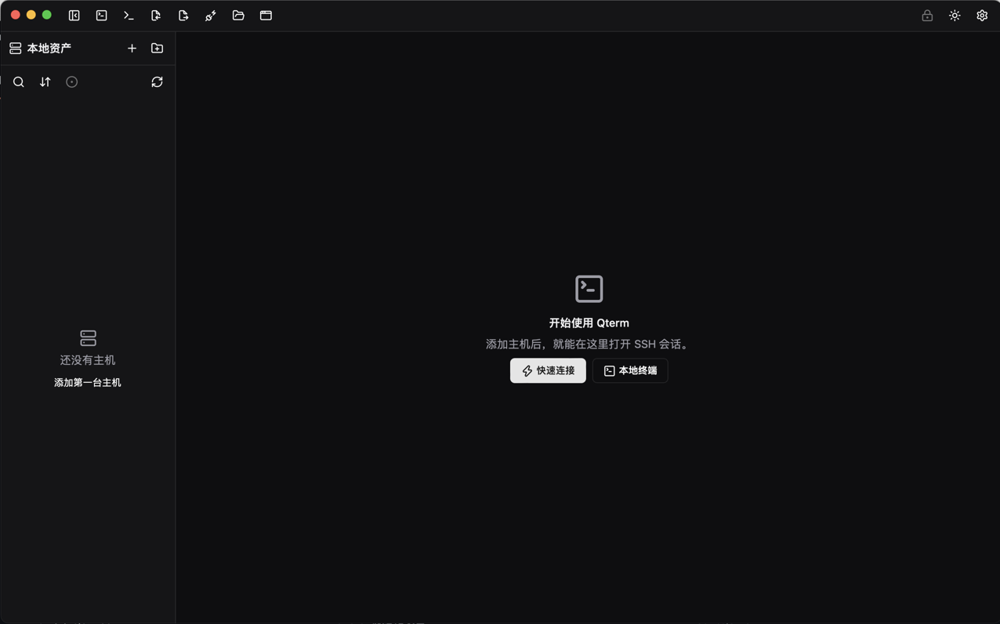
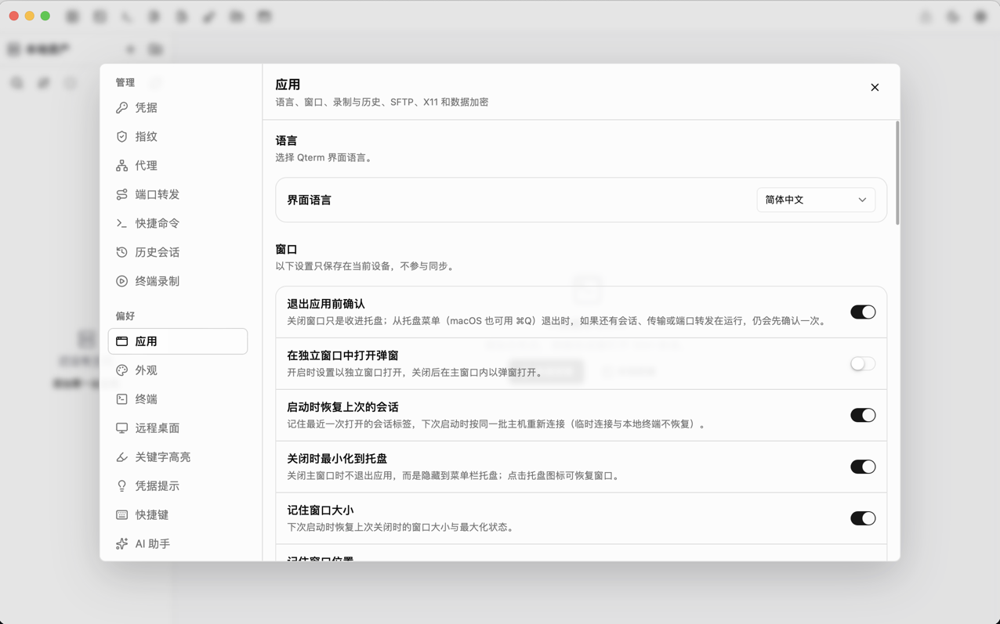

<p align="center">
  
</p>

<h1 align="center">Qterm</h1>

<p align="center">Réunir le terminal, le transfert de fichiers, le bureau à distance et l’exploitation quotidienne dans un même espace de travail.</p>

<p align="center">
  <a href="README.md">简体中文</a> ·
  <a href="README.zh-TW.md">繁體中文</a> ·
  <a href="README.en.md">English</a> ·
  <a href="README.ja.md">日本語</a> ·
  <a href="README.ko.md">한국어</a> ·
  <strong>Français</strong> ·
  <a href="README.ru.md">Русский</a>
</p>

Qterm est un outil de gestion de connexions de bureau construit avec **Go, Wails v3, Vue 3 et TypeScript**, destiné à macOS, Windows et Linux. À partir d’un inventaire d’hôtes, connectez-vous à des serveurs et des appareils dans un espace de travail à onglets et à volets divisés, et traitez vos fichiers, surveillez les ressources, gérez les conteneurs et utilisez l’assistant IA depuis le panneau d’outils latéral.

L’interface est disponible en sept langues : chinois simplifié, chinois traditionnel, anglais, français, japonais, coréen et russe.

## Captures d’écran

**Terminal, SFTP et menu contextuel**



<details>
<summary>Volets divisés et arrière-plan personnalisé</summary>



</details>

<details>
<summary>Thèmes clair et sombre</summary>

**Accueil en thème clair**



**Accueil en thème sombre**



</details>

<details>
<summary>Paramètres de l’application</summary>



</details>

## Vue d’ensemble des fonctionnalités

### Hôtes et connexions

- **Bibliothèque d’actifs unifiée** : gestion des hôtes et des groupes imbriqués, recherche, étiquettes, notes, icônes et couleurs personnalisées, vues latérale et plein écran de l’inventaire.
- **Modes de connexion variés** : SSH, Telnet, port série, RDP, VNC, ainsi que l’ouverture d’un shell local.
- **Authentification SSH** : mot de passe, clé privée, SSH Agent, authentification interactive, et configuration de l’authentification à deux facteurs liée à une entrée OTP.
- **Accès réseau complexe** : chaînes de bastions SSH, proxys SOCKS5 / HTTP ; les configurations de proxy sont réutilisables, et RDP comme VNC peuvent passer par un bastion ou une chaîne de proxys.
- **Options de connexion** : paramètres de terminal, d’encodage, de keepalive, de commande après connexion, SFTP et bureau à distance, définis par protocole.

### Espace de travail du terminal

- Onglets multi-sessions, verrouillage et renommage des onglets, réorganisation par glisser-déposer, volets divisés, ainsi que le détachement et le rattachement des fenêtres de session.
- Recherche dans le terminal, surlignage de mots-clés par expression régulière configurable, historique des commandes, complétion et commandes rapides groupées.
- Confirmation de collage multiligne configurable, commandes par lots, comportement du clic droit, police, curseur, mémoire tampon de défilement et mode de rendu.
- Historique et notes de session, enregistrement du terminal, relecture et exportation.
- Thème clair / sombre, palettes du terminal, image d’arrière-plan et mise à l’échelle de l’interface.

### Fichiers et exploitation

- **SFTP** : navigation dans les répertoires locaux et distants, envoi et téléchargement, transfert par glisser-déposer, file d’attente des transferts, progression et annulation, confirmation d’écrasement, et suivi du répertoire.
- **Édition de texte à distance** : ouverture d’un fichier distant dans l’éditeur intégré, enregistrement après modification, et traitement des conflits de modification.
- **Redirection de ports** : redirections locale, distante et dynamique SOCKS, avec prise en charge des groupes et de l’état d’exécution.
- **Surveillance des ressources** : consultation des métriques CPU, mémoire, disque et réseau ainsi que de leurs courbes historiques ; les métriques disponibles dépendent de l’environnement distant.
- **Processus et services** : consultation des processus, gestion des services sur les systèmes pris en charge et lecture des journaux.
- **Docker** : gestion des conteneurs, images, volumes et réseaux distants via la session SSH active, consultation des détails des ressources et des journaux des conteneurs.
- **Outils d’authentification** : gestion des entrées TOTP / HOTP, import `otpauth://` ou par QR code, affichage des codes, copie et présentation du QR code.

### Assistant IA

Dialoguez en streaming dans l’espace de travail, analysez un problème à partir du terminal, de l’hôte et d’autres contextes sélectionnés, et laissez les outils Agent vous assister dans l’exécution des tâches.

- Configuration de plusieurs fournisseurs de modèles, adresses de service, modèles et clés API, avec aperçu de la connexion.
- Prise en charge des protocoles OpenAI Chat Completions, OpenAI Responses et Anthropic Messages ; les capacités concrètes d’un service compatible dépendent de son implémentation.
- Historique des conversations, affichage Markdown / code / formules mathématiques, approbation des commandes et réglages du comportement de l’Agent.
- Les commandes de l’Agent sont exécutées selon la politique de sécurité locale et la configuration d’approbation ; l’appel natif d’outils est pris en charge par OpenAI Chat Completions et Anthropic, tandis que Responses utilise un repli compatible.

Configurez vous-même le service de modèle avant d’utiliser l’IA. Le contenu ajouté au contexte est envoyé au service configuré ; choisissez le contexte en fonction de la portée réelle de vos données.

## Pages et points d’entrée

| Page / zone                             | Ce que vous pouvez y faire                                                                                                                                                                                   |
| --------------------------------------- | ------------------------------------------------------------------------------------------------------------------------------------------------------------------------------------------------------------ |
| Bibliothèque d’actifs et barre latérale | Rechercher et organiser les hôtes, gérer les groupes, ouvrir des connexions, importer une configuration existante                                                                                            |
| Éditeur d’hôte                          | Configurer l’adresse, l’authentification, le bastion / proxy et les paramètres de connexion avancés selon le protocole                                                                                       |
| Espace de travail de session            | Utiliser le terminal ou le bureau à distance, changer d’onglet, diviser les volets, détacher les fenêtres                                                                                                    |
| Panneau d’outils de droite              | Ouvrir la surveillance des ressources, les processus, les services, Docker, SFTP, les commandes rapides, l’historique des commandes, la redirection de ports, l’authentification, le thème et l’assistant IA |
| Paramètres → Gestion                    | Identifiants, empreintes, proxys, redirection de ports, commandes rapides, historique des sessions, enregistrements du terminal                                                                              |
| Paramètres → Préférences                | Application, apparence, terminal, bureau à distance, surlignage des mots-clés, suggestions d’identifiants, raccourcis clavier, assistant IA, à propos                                                        |
| Paramètres → À propos                   | Version et mises à jour, import et export, etc.                                                                                                                                                              |

Le panneau d’outils s’ouvre selon le type de session et l’état de la connexion ; Docker, par exemple, nécessite une session SSH connectée et un environnement Docker distant.

## Prise en main

1. Lancez l’application et suivez l’assistant pour initialiser ou déverrouiller le coffre-fort local.
2. Créez des groupes et des hôtes, choisissez le protocole et renseignez les informations de connexion ; vous pouvez aussi importer des hôtes depuis un client existant.
3. Pour un hôte SSH, configurez un mot de passe, une clé privée ou SSH Agent ; lors de la première connexion, vérifiez et confirmez l’empreinte de l’hôte.
4. Ouvrez la session de l’hôte et choisissez les outils nécessaires à droite ; pour l’IA, configurez d’abord le service de modèle dans « Paramètres → Assistant IA ».
5. Ajustez dans les paramètres l’apparence, le terminal, les raccourcis clavier, l’enregistrement et les préférences de transfert de fichiers.

### Migration de la configuration

L’import est disponible depuis la configuration OpenSSH, PuTTY, Xshell, Termius, SecureCRT, MobaXterm, WindTerm, FinalShell, Electerm et les fichiers de session JSON ; l’import et l’export des sauvegardes de ressources Qterm sont également pris en charge.

L’import analyse et prévisualise d’abord les données, puis vous sélectionnez les entrées souhaitées. Selon la source, les protocoles, identifiants et options avancées migrables diffèrent : il ne s’agit pas d’une copie complète de la configuration du client d’origine ; le mot de passe principal ou l’accès aux identifiants système peut aussi demander une saisie supplémentaire.

### Données locales et identifiants

Les hôtes, les groupes et l’historique sont stockés dans une base SQLite locale ; les informations secrètes sont gérées par un coffre-fort chiffré. Le coffre-fort utilise AES-256-GCM, la protection par mot de passe principal repose sur une dérivation Argon2id, et des points d’entrée pour la rotation de clé et le paquet de récupération sont fournis. La première connexion SSH nécessite la confirmation de la clé de l’hôte ; les empreintes approuvées sont gérables dans les paramètres.

## Plateformes et limites d’utilisation

| Plateforme | Cibles de distribution | Dépendances d’exécution / remarques                                                                                                                         |
| ---------- | ---------------------- | ----------------------------------------------------------------------------------------------------------------------------------------------------------- |
| macOS      | Apple Silicon / Intel  | Utilise le WebView du système ; le paquet portable local recourt à une signature temporaire, la signature définitive et la notarisation restent à finaliser |
| Windows    | amd64 / arm64          | Nécessite WebView2 Runtime                                                                                                                                  |
| Linux      | amd64 / arm64          | Nécessite les bibliothèques d’exécution GTK / WebKit correspondant à la cible de compilation                                                                |

- **RDP nécessite un helper supplémentaire** : utilise un helper basé sur FreeRDP et ses bibliothèques dynamiques. L’entrée de packaging local pour les six plateformes ne l’embarque que si le helper macOS correspond à l’architecture cible ; Windows / Linux ne l’embarquent pas automatiquement. Sans le helper correspondant, RDP n’est pas utilisable directement.
- **Les outils distants dépendent de l’environnement** : SFTP nécessite un sous-système fourni par le serveur, Docker nécessite la CLI et les droits côté distant, la gestion des services et la surveillance dépendent du système d’exploitation et des outils installés.
- **L’aperçu dans le navigateur ne sert qu’au développement de l’interface** : la passerelle mémoire de la page web ne remplace pas les capacités natives SSH, SFTP, bureau à distance ou coffre-fort.
- **Mise à jour automatique intégrée** : l’application de bureau peut vérifier les GitHub Release, télécharger en arrière-plan et vérifier le SHA-256, puis l’utilisateur confirme le redémarrage pour installer ; une notification apparaît dans la barre supérieure une fois la mise à jour prête. Le parcours complet d’une Release réelle, le remplacement et le redémarrage sous Windows / Linux, ainsi que la CI de publication restent à valider sur machine réelle.
- **La validation multiplateforme est en cours** : les cibles de compilation et l’implémentation existante ne signifient pas que toutes les fonctionnalités ont été validées sur les six combinaisons système / architecture.

## Développement local

### Préparation de l’environnement

| Outil                            | Base actuelle du projet                                                                                                                      |
| -------------------------------- | -------------------------------------------------------------------------------------------------------------------------------------------- |
| Go                               | 1.26.0 ou une version compatible avec `go.mod`                                                                                               |
| Node.js                          | 22.x à partir de 22.22.2, ou 24.x à partir de 24.15.0 ; doit satisfaire les exigences engines des dépendances verrouillées                   |
| npm                              | Installe les dépendances frontend verrouillées                                                                                               |
| Wails CLI                        | v3.1.0, aligné sur la version du module Go                                                                                                   |
| Chaîne d’outils de la plateforme | macOS nécessite les Xcode Command Line Tools ; les autres plateformes doivent fournir les dépendances natives de compilation correspondantes |

Exécutez à la racine du dépôt :

```sh
go install github.com/wailsapp/wails/v3/cmd/wails3@v3.1.0
npm --prefix frontend ci
wails3 doctor
wails3 task dev
```

Assurez-vous que le répertoire des exécutables Go figure dans `PATH`. `wails3 task dev` utilise `build/config.yml` ; le port frontend par défaut est `9245`.

Aperçu du frontend seul (ouvrez `http://127.0.0.1:9245` dans un navigateur ; la passerelle mémoire est alors utilisée, sans capacités SSH / SFTP réelles) :

```sh
npm --prefix frontend run dev
```

### Vérification et compilation

```sh
# Vérification locale complète : format Go, tests, vet ; format, lint, types, tests unitaires, build et E2E du frontend
wails3 task check

# Compilation de l’application pour la plateforme actuelle
wails3 build

# Génération du paquet d’installation / de distribution pour la plateforme actuelle
wails3 package
```

La vérification complète nécessite les fichiers de test du dépôt et l’environnement de navigateur Playwright ; un instantané de code seul ne contient pas la porte de test complète. Installez le navigateur E2E si nécessaire :

```sh
cd frontend
npx playwright install chromium
```

### Paquet portable six plateformes

Exécutez à la racine du dépôt sous **macOS** :

```sh
# Afficher uniquement le plan
wails3 task release:all DRY_RUN=true

# Compilation réelle
wails3 task release:all
```

Nécessite Go, Node.js/npm, Wails CLI, les Xcode Command Line Tools et Docker Desktop démarré. Le premier lancement construit l’image de compilation croisée Linux et nécessite un accès réseau.

Les artefacts sont écrits dans un nouveau répertoire sous `bin/releases/` : archives ZIP macOS / Windows, tar.gz Linux, et `SHA256SUMS` généré si toutes les étapes réussissent. La commande ne téléverse rien automatiquement et ne produit ni DMG, ni NSIS, ni deb, ni rpm.

Le dépôt fournit aussi un workflow GitHub Actions Release qui compile les six cibles à partir d’un tag de version et regroupe les fichiers de vérification ; la validation sur les runners réels du workflow reste à faire.

### Convention de commit

Les messages de commit suivent Conventional Commits (`<type>(<scope>): <subject>`), vérifiés par commitlint et générés par czg :

```sh
npm install        # Première fois : installe czg / commitlint / husky et active le hook commit-msg
npm run commit     # Génère le message de commit de façon interactive
```

- **type** : `feat`, `fix`, `docs`, `style`, `refactor`, `perf`, `test`, `build`, `ci`, `chore`, `revert`, `wip`, `workflow`, `types`, `release`.
- **scope** : les noms des répertoires de `internal/*` et `frontend/src/features/*` deviennent automatiquement des scopes disponibles, auxquels s’ajoutent `project`, `deps`, `build`, `ci`, `release`, `docs`, `scripts`, `i18n`, `ui`, `other` ; le scope peut être omis.
- **header** : 108 caractères au maximum, le subject ne peut pas être vide ; un message non conforme est refusé.

Le détail des règles se trouve dans `docs/development/commit-convention.md` (ce répertoire n’est conservé que dans le dépôt interne).

## Technologies et arborescence

| Partie                        | Technologies                                                 |
| ----------------------------- | ------------------------------------------------------------ |
| Conteneur de bureau           | Wails v3.1.0, Go                                             |
| Frontend                      | Vue 3, TypeScript, Vite, Tailwind CSS, Reka UI               |
| Terminal et bureau à distance | xterm.js, noVNC, helper FreeRDP                              |
| Éditeur                       | CodeMirror, Monaco Editor                                    |
| Stockage et chiffrement       | SQLite, AES-256-GCM, Argon2id                                |
| Contrôle qualité              | Go test / vet, Vitest, Playwright, ESLint, Prettier, vue-tsc |

```text
main.go                  Point d’entrée de l’application et intégration des ressources
internal/app/            Façade Wails, assemblage, fenêtre et pont runtime
internal/                Hôtes, sessions, terminal, SFTP, IA et autres fonctions et infrastructures
frontend/src/app/        Enveloppe de l’application et point d’entrée des fenêtres
frontend/src/features/   Pages, panneaux et logique d’état organisés par fonction
frontend/src/services/   Passerelles frontend et encapsulation des services runtime
frontend/src/components/ Contrôles communs, mise en page, dialogues et composants de l’espace de travail
frontend/src/locales/    Textes d’interface en sept langues
frontend/bindings/       Bindings TypeScript Wails générés
build/                   Configuration de compilation par plateforme et scripts de publication
tools/                   Sources du helper RDP, fixtures de test local OTP
Taskfile.yml             Points d’entrée des tâches de développement, vérification et compilation
```

Pour le détail des responsabilités des répertoires, voir [`internal/README.md`](internal/README.md) et [`frontend/README.md`](frontend/README.md).
